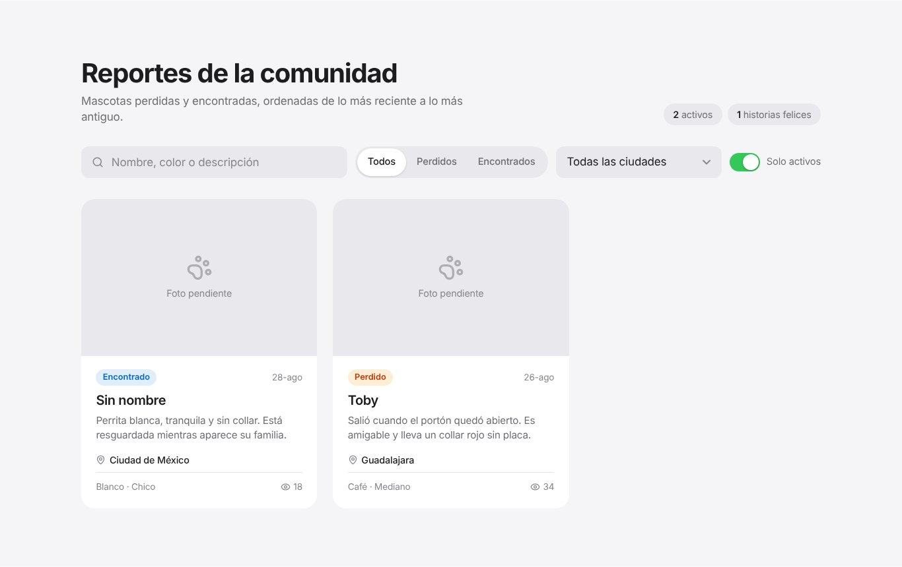
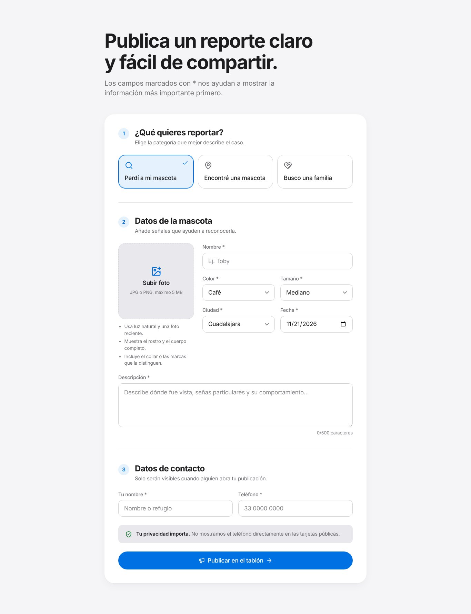
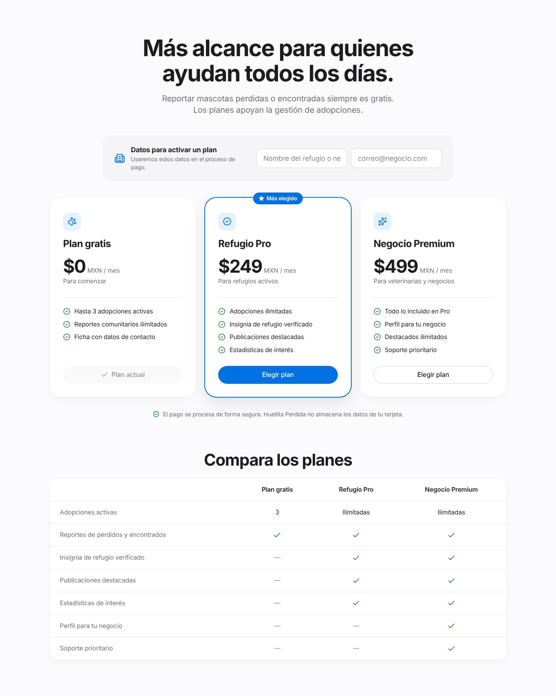
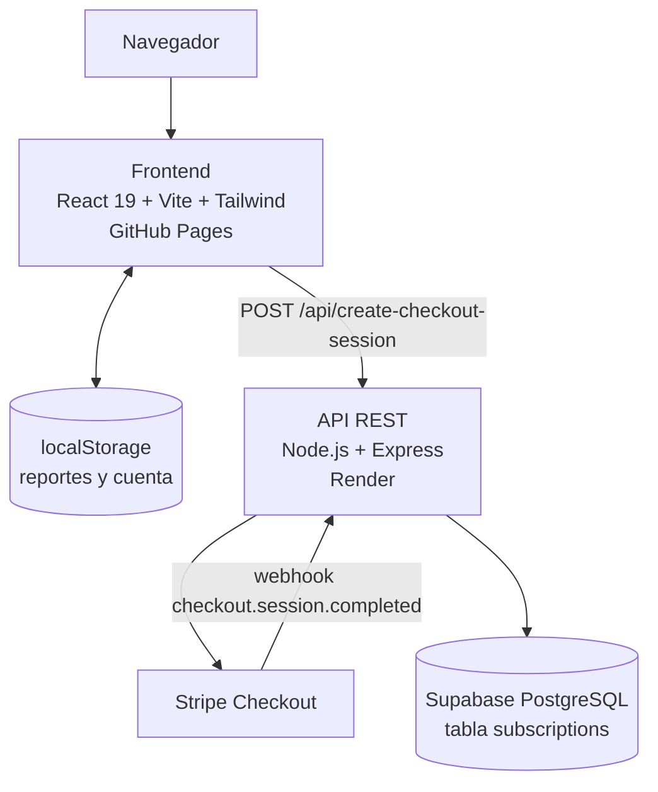

<div align="center">

# 🐾 Huellita Perdida

**Reporta, busca y comparte mascotas perdidas, encontradas y en adopción en tu ciudad.**

[](https://github.com/PapiJoshh/Huellitas/actions/workflows/deploy-frontend.yml)


[**Ver sitio**](https://papijoshh.github.io/Huellitas/) · [**Documentación**](docs/README.md) · [**Documento integrador (PDF)**](docs/Producto-Integrador_Huellitas.pdf)


</div>

---

## Sobre el proyecto

Cuando una mascota se pierde, las primeras horas son decisivas, pero la difusión suele quedar dispersa en redes sociales y grupos de mensajería. **Huellita Perdida** centraliza los reportes en un tablón con filtros por ciudad y tipo, protege el teléfono de quien publica y ofrece a refugios y veterinarias herramientas para dar visibilidad a sus adopciones.

> Proyecto del **Equipo 2** para el producto integrador *La definición de un sistema Web* (Universidad de Guadalajara · UDG Plus).

## Funcionalidades

- 🔎 **Tablón de reportes** de mascotas perdidas y encontradas, con búsqueda y filtros por tipo, ciudad y estado.
- 🏡 **Adopciones** con edad, vacunación y esterilización, y la sección *Ya volvieron a casa*.
- 📝 **Formulario guiado en tres pasos** con foto, datos de la mascota y contacto.
- 🔒 **Privacidad por diseño:** el teléfono solo se muestra cuando alguien abre la publicación y decide verlo.
- 💳 **Planes de pago** para refugios y negocios con Stripe Checkout (modo demostración sin claves).
- 🛟 **Ayuda:** guías para quien perdió, encontró o quiere adoptar, recomendaciones de seguridad y preguntas frecuentes.

### Planes

| | Gratis | Refugio Pro | Negocio Premium |
|---|:---:|:---:|:---:|
| Precio | $0 | $249 MXN / mes | $499 MXN / mes |
| Reportes de perdidos y encontrados | ✅ | ✅ | ✅ |
| Adopciones activas | 3 | Ilimitadas | Ilimitadas |
| Insignia de refugio verificado | — | ✅ | ✅ |
| Publicaciones destacadas | — | ✅ | ✅ |
| Estadísticas de interés | — | ✅ | ✅ |
| Perfil para tu negocio y soporte prioritario | — | — | ✅ |

## Capturas

| Reportes | Publicar | Planes |
|:---:|:---:|:---:|
|  |  |  |

## Arquitectura



| Capa | Tecnología |
|---|---|
| Interfaz | React 19, Vite 8, Tailwind CSS 3.4, Lucide |
| Servidor | Node.js, Express 4 |
| Pagos | Stripe Checkout |
| Datos | Supabase (PostgreSQL con RLS) |
| Despliegue | GitHub Pages (frontend, con GitHub Actions) y Render (API) |

## Inicio rápido

**Requisitos:** Node.js 20 o superior.

```bash
git clone https://github.com/PapiJoshh/Huellitas.git
cd Huellitas

npm install                    # herramientas de la raíz
npm install --prefix frontend
npm install --prefix backend

cp backend/.env.example backend/.env    # opcional: sin claves, el pago corre en modo demostración
npm run dev
```

- Frontend: <http://localhost:5173/Huellitas/>
- API: <http://localhost:3001/api/health>

### Variables de entorno

| Archivo | Variable | Descripción |
|---|---|---|
| `backend/.env` | `STRIPE_SECRET_KEY` | Clave secreta de Stripe (modo test: `sk_test_…`) |
| | `STRIPE_WEBHOOK_SECRET` | Secreto de firma del webhook |
| | `SUPABASE_URL` | URL del proyecto de Supabase |
| | `SUPABASE_SERVICE_ROLE_KEY` | Clave de servicio (solo en el servidor) |
| | `CLIENT_URL` | URL pública del frontend |
| | `PORT` | Puerto de la API (3001 por defecto) |
| `frontend/.env` | `VITE_API_URL` | URL pública de la API |

> ⚠️ Nunca subas archivos `.env` ni claves secretas al repositorio.

Para probar el pago en modo test de Stripe usa la tarjeta `4242 4242 4242 4242`, cualquier fecha futura y cualquier CVC. Ejecuta `backend/supabase/schema.sql` en el editor SQL de Supabase para crear la tabla de suscripciones.

### Scripts

| Comando | Qué hace |
|---|---|
| `npm run dev` | Levanta API y frontend a la vez |
| `npm run build` | Compila el frontend en `frontend/dist` |
| `npm run preview` | Sirve la compilación local |
| `npm run server` | Levanta solo la API |
| `npm run test:gold` | Prueba de humo: API, checkout y compilación |

### API

| Método | Ruta | Descripción |
|---|---|---|
| `GET` | `/api/health` | Estado del servidor y de los servicios configurados |
| `POST` | `/api/create-checkout-session` | Crea la sesión de pago de un plan (`pro` o `premium`) |
| `POST` | `/api/checkout/success` | Registra el éxito de pago desde el cliente |
| `POST` | `/api/webhook/stripe` | Webhook firmado de Stripe que activa la suscripción |

## Estructura del repositorio

```text
Huellitas/
├── frontend/              # React + Vite + Tailwind
│   └── src/               #   App.jsx, sections.jsx, lib/payments.js
├── backend/               # API Express
│   ├── index.js
│   └── supabase/schema.sql
├── docs/                  # Documentación del producto integrador
│   ├── 01-planeacion/     #   problema, objetivos, matriz RACI, Gantt
│   ├── 02-requerimientos/
│   ├── 03-diseno/         #   carta de navegación, wireframes, casos de uso
│   ├── 04-tecnologia/     #   framework seleccionado y justificación
│   ├── 05-prototipos/     #   maquetas y capturas
│   └── assets/            #   diagramas, wireframes y capturas
├── scripts/golden-test.cjs
├── .github/workflows/     # Despliegue automático a GitHub Pages
└── render.yaml            # Configuración del servicio en Render
```

## Documentación

| Apartado | Documento |
|---|---|
| Planteamiento del problema, contexto y justificación | [docs/01-planeacion](docs/01-planeacion/01-planteamiento-del-problema.md) |
| Planeación y objetivos | [docs/01-planeacion](docs/01-planeacion/02-planeacion-y-objetivos.md) |
| Matriz de responsabilidades | [docs/01-planeacion](docs/01-planeacion/03-matriz-de-responsabilidades.md) |
| Diagrama de Gantt | [docs/01-planeacion](docs/01-planeacion/04-diagrama-de-gantt.md) |
| Requerimientos | [docs/02-requerimientos](docs/02-requerimientos/requerimientos.md) |
| Carta de navegación | [docs/03-diseno](docs/03-diseno/01-carta-de-navegacion.md) |
| Wireframes | [docs/03-diseno](docs/03-diseno/02-wireframes.md) |
| Casos de uso | [docs/03-diseno](docs/03-diseno/03-casos-de-uso.md) |
| CMS o framework seleccionado | [docs/04-tecnologia](docs/04-tecnologia/framework-seleccionado.md) |
| Prototipos y maquetas | [docs/05-prototipos](docs/05-prototipos/prototipos-y-maquetas.md) |
| **Documento integrador completo** | [Word](docs/Producto-Integrador_Huellitas.docx) · [PDF](docs/Producto-Integrador_Huellitas.pdf) |

## Estado y hoja de ruta

El prototipo es funcional de extremo a extremo para el flujo de reportes, adopciones y contratación de planes. Los reportes y la cuenta se guardan por ahora en el navegador.

- [ ] Inicio de sesión y reportes en base de datos compartida
- [ ] Activación de planes solo desde el webhook firmado de Stripe
- [ ] Moderación y verificación de refugios
- [ ] Compartir por WhatsApp y notificaciones por correo

## Equipo

**Equipo 2 · Universidad de Guadalajara (UDG Plus)**

- Joshua Jonathan Moran Cruz — [@PapiJoshh](https://github.com/PapiJoshh)
- Andrea Cristina
- Jahir Cruz
