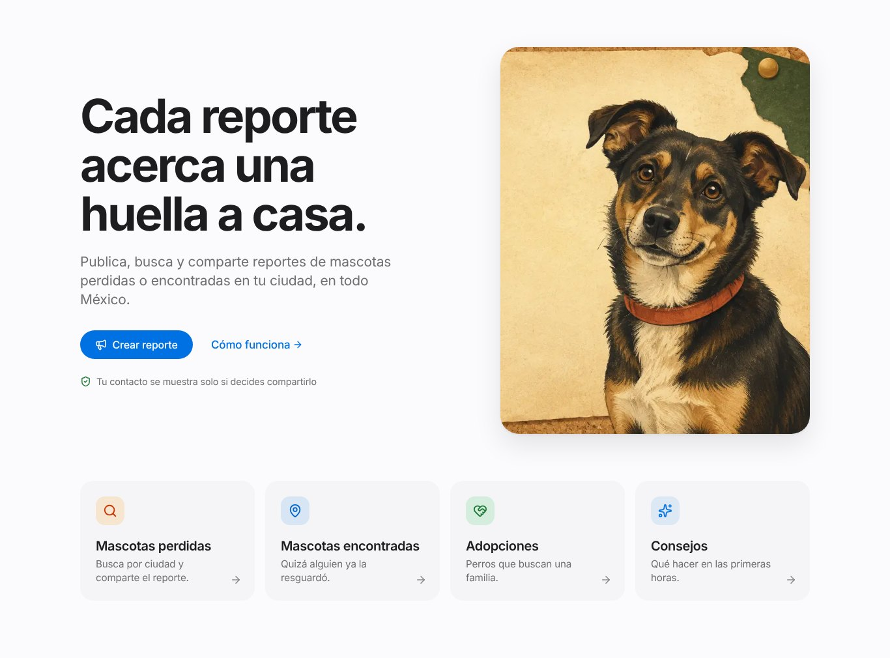

<div align="center">


# Huellita Perdida

Página para reportar mascotas perdidas, encontradas y en adopción.

[Ver sitio](https://papijoshh.github.io/Huellitas/) · [Documentación](docs/README.md) · [Documento integrador (PDF)](docs/Producto-Integrador_Huellitas.pdf)



</div>

## Sobre el proyecto

Cuando una mascota se pierde, los avisos se riegan entre redes y grupos de mensajes. Huellita Perdida junta los reportes en un solo lugar, con filtros por ciudad y tipo, y sin mostrar el teléfono de quien publica a menos que decida compartirlo. Los refugios y veterinarias pueden contratar un plan para dar más visibilidad a sus adopciones.

Proyecto del Equipo 2 para *La definición de un sistema Web* (UDG Virtual).

## Qué hace

- Reportes de mascotas perdidas y encontradas, con búsqueda y filtros.
- Adopciones y sección de mascotas que ya volvieron a casa.
- Cuentas con correo y contraseña; hay que iniciar sesión para publicar.
- Fotos y reportes guardados en Supabase.
- Planes de pago para refugios con Stripe.
- Ayuda, consejos de seguridad y formulario para comentarios o denuncias.
- Panel de administración (solo para cuentas admin): ver y borrar publicaciones, leer comentarios y denuncias.

## Tecnología

React 19, Vite, Tailwind · Node.js y Express · Supabase (PostgreSQL, Auth, Storage) · Stripe · GitHub Pages y Render.

## Correrlo local

Necesitas Node.js 20 o superior.

```bash
git clone https://github.com/PapiJoshh/Huellitas.git
cd Huellitas
npm install
npm install --prefix frontend
npm install --prefix backend
npm run dev
```

El frontend queda en <http://localhost:5173/Huellitas/> y la API en <http://localhost:3001/api/health>.

Sin variables de entorno funciona en modo local (los datos se guardan en el navegador). Para usar Supabase y Stripe copia `backend/.env.example` a `backend/.env` y `frontend/.env.example` a `frontend/.env`, y corre `backend/supabase/schema.sql` en el SQL Editor de Supabase.

## Estructura

```text
frontend/   React + Vite
backend/    API Express y schema.sql de Supabase
docs/       Documentación del producto integrador
```

## Documentación

Planteamiento, planeación, requerimientos, diseño, tecnología y prototipos están en [docs](docs/README.md). El documento completo: [Word](docs/Producto-Integrador_Huellitas.docx) · [PDF](docs/Producto-Integrador_Huellitas.pdf).

## Equipo

Equipo 2 · Universidad de Guadalajara

- Joshua Jonathan Moran Cruz ([@PapiJoshh](https://github.com/PapiJoshh))
- Andrea Cristina
- Jahir Cruz
