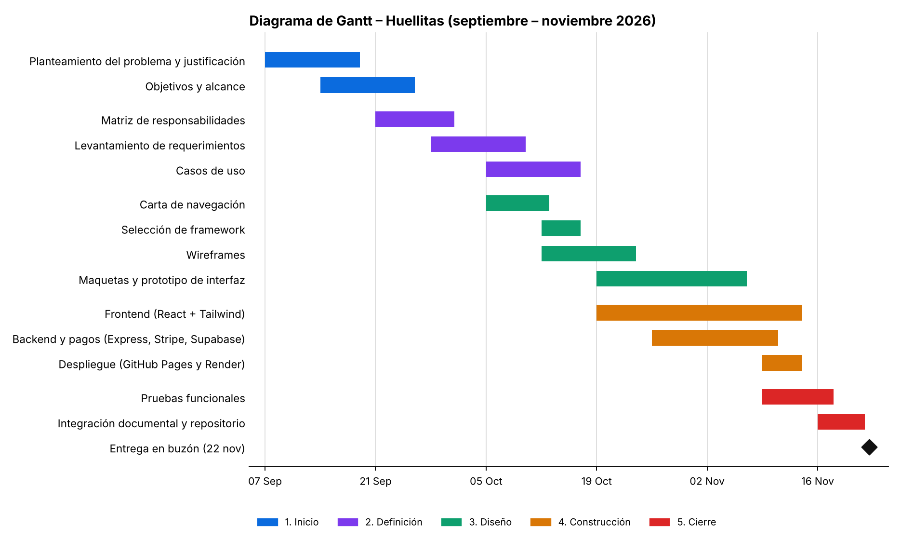

# Diagrama de Gantt

El cronograma abarca del **7 de septiembre al 22 de noviembre de 2026**, fecha de cierre del producto integrador. Las actividades se agrupan en cinco fases y varias se traslapan porque el diseño y la construcción avanzan de forma incremental.

## Hitos

| Hito | Fecha |
|---|---|
| Definición cerrada (requerimientos y casos de uso) | 16 de octubre |
| Wireframes terminados | 23 de octubre |
| Prototipo desplegado | 13 de noviembre |
| Entrega en buzón | 22 de noviembre |

> El diagrama se genera con `docs/assets/diagramas/gantt.py` (matplotlib). Para modificar fechas, edita ese archivo y vuelve a ejecutarlo.
