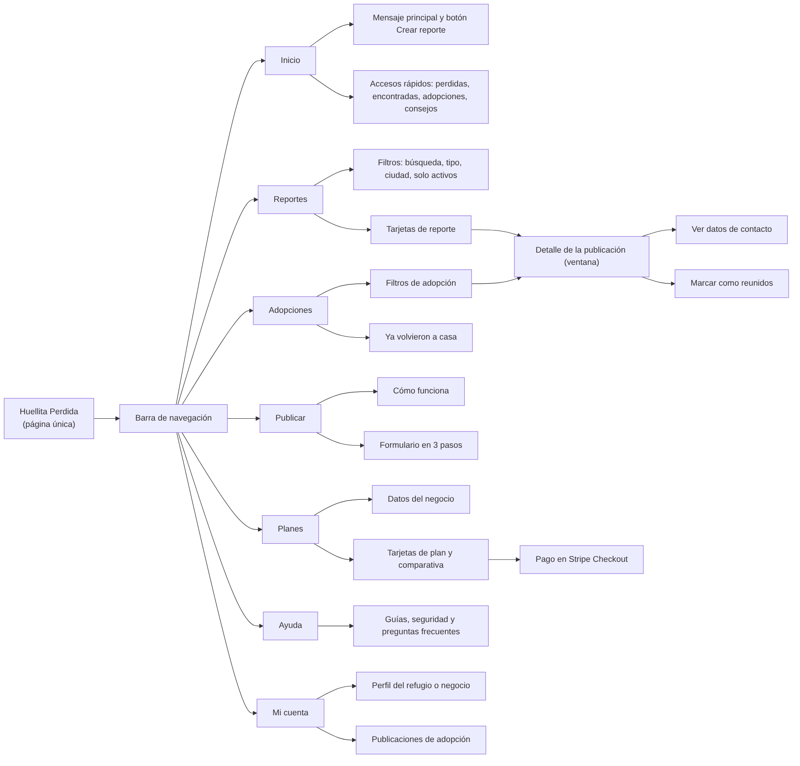

# Carta de navegación del prototipo

El sistema es una aplicación de página única. Todas las secciones están disponibles desde una barra de navegación fija, y la sección activa se resalta conforme la persona se desplaza.

## Descripción de cada apartado

| Apartado | Descripción |
|---|---|
| **Inicio** | Presenta el propósito del sitio con un mensaje principal, el botón «Crear reporte», una nota de privacidad y cuatro accesos rápidos: mascotas perdidas, encontradas, adopciones y consejos. |
| **Reportes** | Tablón de mascotas perdidas y encontradas. Incluye búsqueda por texto, filtro por tipo y ciudad y una casilla para ver solo reportes activos. Cada tarjeta abre el detalle. |
| **Adopciones** | Tablón de perros en adopción con filtros propios. Incluye la sección «Ya volvieron a casa», con historias de reportes resueltos. |
| **Publicar** | Explica en tres pasos cómo funciona el sitio y contiene el formulario de publicación: tipo de reporte, datos de la mascota y datos de contacto. |
| **Planes** | Muestra los planes Gratis, Refugio Pro y Negocio Premium, un formulario con los datos del negocio y una tabla comparativa. El botón «Elegir plan» lleva al pago en Stripe. |
| **Ayuda** | Reúne guías para quien perdió, encontró o quiere adoptar una mascota, recomendaciones de seguridad y preguntas frecuentes. |
| **Mi cuenta** | Permite configurar el perfil del refugio o negocio, consultar el plan activo y ver las publicaciones de adopción propias. |
| **Detalle de publicación** | Ventana emergente con foto, datos completos, botón para ver el contacto y opción de marcar el caso como resuelto. Se cierra con la tecla Escape. |

## Flujos principales

1. **Reportar una mascota perdida:** Inicio → Crear reporte → Publicar → formulario de tres pasos → el reporte aparece en Reportes.
2. **Contactar a quien encontró una mascota:** Reportes → filtrar por ciudad → abrir tarjeta → Ver contacto.
3. **Contratar un plan:** Planes → capturar nombre y correo → Elegir plan → pago en Stripe → regreso al sitio con el plan activo.
