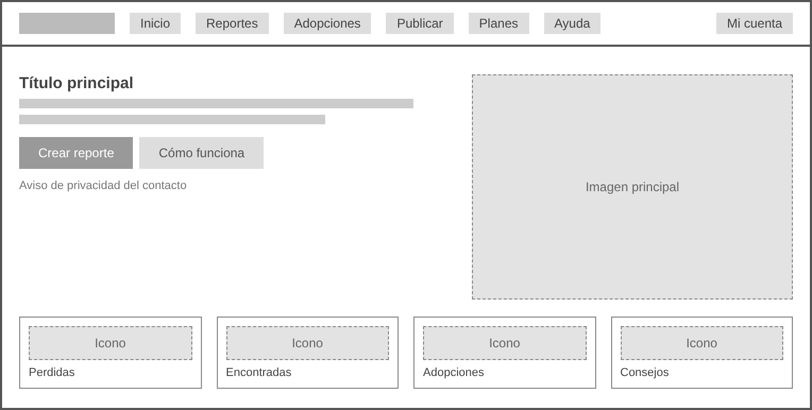
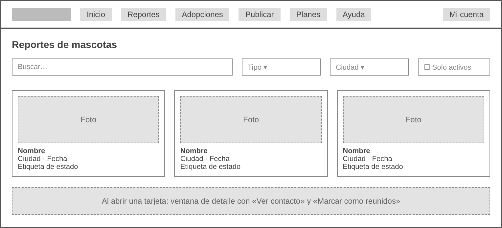
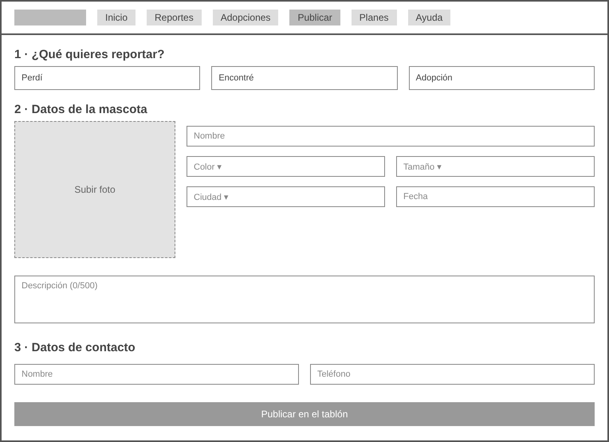
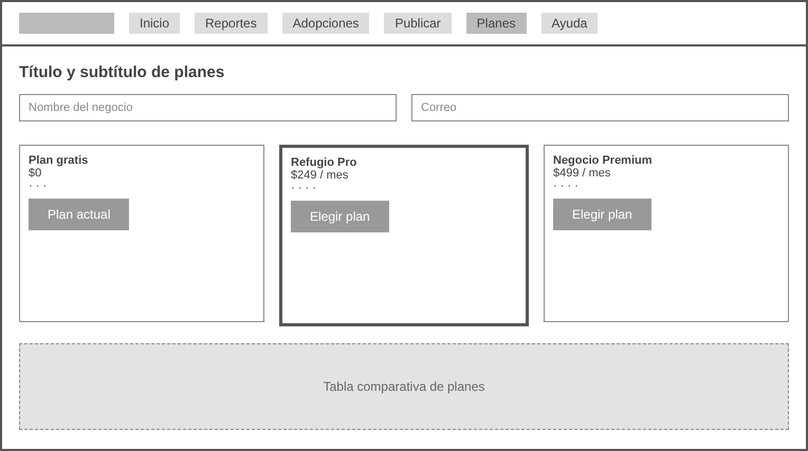

# Diseño de los wireframes

Los wireframes son de baja fidelidad, en escala de grises. Definen la distribución de los elementos antes de aplicar color, tipografía e imágenes. Se elaboraron para las cuatro pantallas con mayor peso en el flujo del usuario.

## W1. Inicio

Barra de navegación, mensaje principal con botones de acción, imagen destacada y cuatro accesos rápidos.

## W2. Tablón de reportes y adopciones

Filtros en una sola fila sobre una cuadrícula de tarjetas. Cada tarjeta lleva foto, nombre, ciudad, fecha y estado.

## W3. Publicar reporte

Formulario dividido en tres pasos numerados para reducir la carga cognitiva.

## W4. Planes

Tres tarjetas de plan con el plan recomendado resaltado y una tabla comparativa debajo.

## Decisiones de diseño

- **Una sola página con anclas**, para que la persona no pierda contexto al cambiar de sección.
- **Formulario en pasos numerados**, para guiar al usuario en un momento de estrés.
- **Plan recomendado resaltado**, para orientar la decisión de los negocios.
- **Contacto oculto por defecto**, por privacidad.
