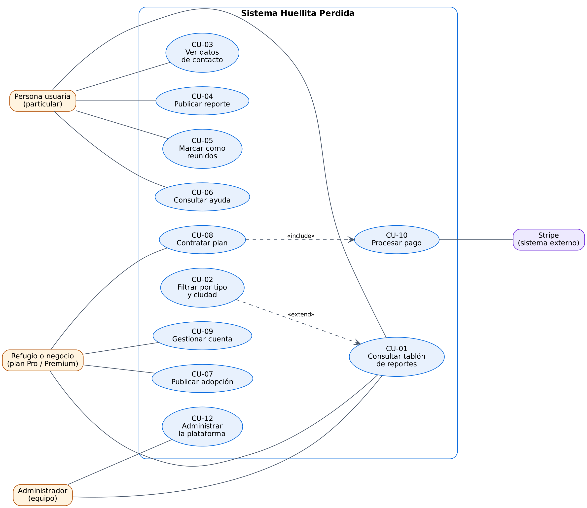

# Casos de uso

## Actores

| Actor | Descripción |
|---|---|
| Persona usuaria (particular) | Quien reporta, busca o consulta mascotas. No requiere pago. |
| Refugio o negocio | Organización que publica adopciones y puede contratar un plan Pro o Premium. |
| Administrador | Integrante del equipo con rol de administrador. Inicia sesión como cualquier persona, pero puede revisar y moderar todo el contenido. |
| Stripe | Sistema externo que procesa el pago y notifica la confirmación al servidor. |

## Diagrama de casos de uso

## Resumen de casos de uso

| ID | Caso de uso | Actor principal |
|---|---|---|
| CU-01 | Consultar tablón de reportes | Persona usuaria, refugio |
| CU-02 | Filtrar por tipo y ciudad | Persona usuaria |
| CU-03 | Ver datos de contacto | Persona usuaria |
| CU-04 | Publicar reporte | Persona usuaria |
| CU-05 | Marcar como reunidos | Persona usuaria |
| CU-06 | Consultar ayuda | Persona usuaria |
| CU-07 | Publicar adopción | Refugio o negocio |
| CU-08 | Contratar plan | Refugio o negocio |
| CU-09 | Gestionar cuenta | Refugio o negocio |
| CU-10 | Procesar pago | Stripe |
| CU-11 | Iniciar sesión o registrarse | Persona usuaria, refugio |
| CU-12 | Administrar la plataforma | Administrador |

## Especificación de los casos principales

### CU-04 Publicar reporte

| Campo | Detalle |
|---|---|
| Actor | Persona usuaria |
| Precondición | La persona inició sesión (CU-11). Reportar es gratuito y no requiere plan. |
| Flujo principal | 1. La persona elige «Publicar» o «Crear reporte». 2. Selecciona el tipo: perdí, encontré o busco una familia. 3. Captura los datos de la mascota y, opcionalmente, sube una foto. 4. Captura nombre y teléfono de contacto. 5. Presiona «Publicar en el tablón». 6. El sistema agrega el reporte al tablón y muestra una confirmación. |
| Flujo alterno | Si no hay sesión, el sistema abre el inicio de sesión. Si falta un campo obligatorio, el sistema lo señala y no publica. Si es adopción y el plan gratuito ya tiene tres activas, el sistema lleva a la persona a Planes. |
| Postcondición | El reporte aparece en el tablón correspondiente con estado «activo». |

### CU-03 Ver datos de contacto

| Campo | Detalle |
|---|---|
| Actor | Persona usuaria |
| Precondición | Existe un reporte activo. |
| Flujo principal | 1. La persona abre una tarjeta del tablón. 2. El sistema muestra el detalle sin el teléfono. 3. La persona elige «Ver contacto». 4. El sistema consulta la base de datos y revela nombre y teléfono. |
| Postcondición | Se incrementa el contador de contactos de la publicación. |

### CU-05 Marcar como reunidos

| Campo | Detalle |
|---|---|
| Actor | Persona usuaria |
| Precondición | La persona inició sesión y abrió el detalle de un reporte suyo. Solo quien publicó puede resolver o eliminar. |
| Flujo principal | 1. Elige «Marcar como reunidos». 2. El sistema cambia el estado a «resuelto». 3. El reporte pasa a la sección «Ya volvieron a casa». |
| Postcondición | El reporte deja de aparecer entre los activos. |

### CU-11 Iniciar sesión o registrarse

| Campo | Detalle |
|---|---|
| Actor | Persona usuaria o refugio |
| Precondición | Ninguna. |
| Flujo principal | 1. La persona elige «Iniciar sesión». 2. Captura correo y contraseña (mínimo 6 caracteres). 3. El sistema valida las credenciales con Supabase Auth. 4. La sesión queda activa y se carga su perfil y su plan. |
| Flujo alterno | Si es la primera vez, elige «Regístrate» y el sistema crea la cuenta. Si las credenciales son incorrectas, el sistema lo indica. |
| Postcondición | La persona puede publicar, administrar sus reportes y contratar planes. |

### CU-12 Administrar la plataforma

| Campo | Detalle |
|---|---|
| Actor | Administrador |
| Precondición | La cuenta del administrador está registrada en la tabla `admins` de la base de datos (solo se asigna desde Supabase, nunca desde el sitio). |
| Flujo principal | 1. Inicia sesión con su correo y contraseña. 2. El sistema consulta su rol y muestra el botón «Admin». 3. Abre el panel de administración. 4. Revisa publicaciones, comentarios, denuncias y usuarios registrados. 5. Marca como resuelta o elimina una publicación, o elimina un comentario. |
| Flujo alterno | Si la cuenta no es administradora, el sistema no muestra el panel y la base de datos rechaza cualquier intento de borrar contenido ajeno. |
| Postcondición | El contenido moderado deja de mostrarse al público; al eliminar una publicación se elimina también su foto. |

### CU-08 Contratar plan

| Campo | Detalle |
|---|---|
| Actor | Refugio o negocio |
| Precondición | Inició sesión y capturó nombre del negocio y correo. |
| Flujo principal | 1. Elige «Elegir plan» en Refugio Pro o Negocio Premium. 2. El sistema solicita una sesión de pago al servidor (CU-10). 3. La persona completa el pago en Stripe. 4. Stripe redirige al sitio. 5. El webhook activa el plan y el sistema lo consulta en la base de datos. |
| Flujo alterno | Si el servidor no responde, el sistema avisa que debe reintentar. Si Stripe no está configurado, se activa el modo demostración. Si la persona cancela el pago, el plan no cambia. |
| Postcondición | La cuenta muestra el plan contratado, la insignia de verificado y los destacados. |

### CU-10 Procesar pago

| Campo | Detalle |
|---|---|
| Actor | Stripe |
| Flujo principal | 1. El servidor crea la sesión de Checkout con el plan y el monto en pesos mexicanos. 2. Stripe cobra y envía el evento «checkout.session.completed» al webhook. 3. El servidor valida la firma y guarda la suscripción, ligada a la cuenta, en Supabase con estado «active». |
| Postcondición | La suscripción queda registrada en la base de datos. |
