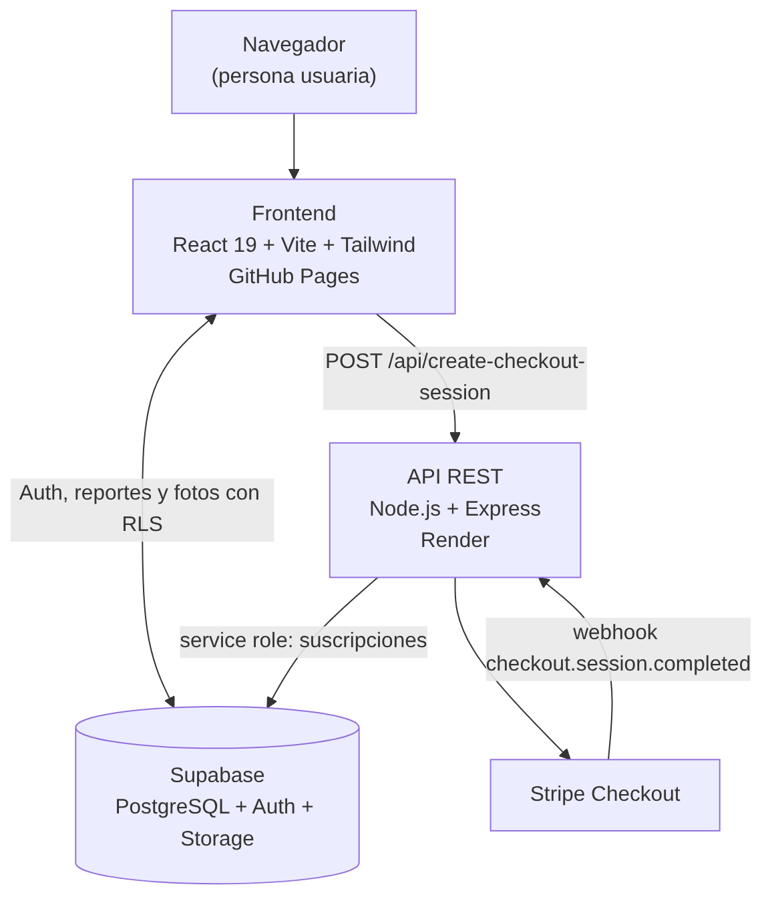

# CMS o framework seleccionado y justificación

## Decisión

Se seleccionó un **stack basado en frameworks de JavaScript** en lugar de un CMS:

| Capa | Tecnología | Versión |
|---|---|---|
| Interfaz | **React** | 19 |
| Herramienta de compilación | **Vite** | 8 |
| Estilos | **Tailwind CSS** | 3.4 |
| Iconos | Lucide React | 1.x |
| Servidor | **Node.js + Express** | Express 4 |
| Pagos | **Stripe Checkout** | SDK 17 |
| Base de datos | **Supabase (PostgreSQL)** | SDK 2 |
| Publicación | GitHub Pages (frontend) y Render (API) | — |

## Alternativas evaluadas

| Criterio | WordPress (CMS) | Laravel + Angular | **React + Express (elegida)** |
|---|---|---|---|
| Interactividad (filtros, formulario por pasos, ventana de detalle) | Media; depende de plugins o JavaScript a medida | Alta | **Alta** |
| Lógica de negocio propia (planes, límites, pagos) | Requiere plugins de membresía y comercio | Alta | **Alta** |
| Contenido generado por usuarias y usuarios | Posible, con plugins y moderación pesada | Alta | **Alta** |
| Costo de hosting inicial | Hosting con PHP y base de datos | Hosting con PHP y base de datos | **Cero: hosting estático y plan gratuito** |
| Control sobre el diseño | Limitado por el tema | Alto | **Alto** |
| Una sola tecnología en cliente y servidor | No | No | **Sí (JavaScript)** |
| Tiempo para tener un prototipo funcional | Corto para un sitio informativo | Largo | **Corto** |

## Razones de la elección

1. **El producto es una aplicación, no un sitio de contenido.** Los filtros en tiempo real, el formulario guiado, el detalle emergente y la lógica de planes son comportamiento de aplicación. Un CMS está pensado para administrar páginas y entradas, y habría exigido varios plugins para aproximarse a lo mismo.
2. **Control de la lógica de negocio.** Los límites del plan gratuito, las insignias y el flujo de pago son reglas propias del producto. Con un servidor Express pequeño se implementan y se prueban de forma directa.
3. **Costo cero de operación.** Vite genera archivos estáticos que se publican en GitHub Pages, y el servidor corre en el plan gratuito de Render. Un CMS necesitaría hosting con base de datos desde el inicio.
4. **Un solo lenguaje.** JavaScript en interfaz y servidor facilita que el equipo comparta conocimiento y revise el código de todos.
5. **Seguridad del cobro.** Stripe Checkout evita que la aplicación maneje datos de tarjeta, lo que reduce el riesgo y el alcance de seguridad.
6. **Ecosistema y mantenimiento.** React, Vite y Tailwind cuentan con comunidad amplia, documentación abundante y herramientas de análisis de código (ESLint) integradas al proyecto.

## Características y funcionalidades aprovechadas

- **React:** componentes reutilizables (tarjetas, filtros, formularios) y manejo de estado para filtros, cuenta y publicaciones.
- **Vite:** servidor de desarrollo con recarga instantánea, compilación optimizada y proxy hacia la API local.
- **Tailwind CSS y CSS propio:** sistema de diseño consistente y adaptable a distintos tamaños de pantalla.
- **Express:** rutas REST para crear la sesión de pago (verifica la sesión de la persona) y recibir el webhook firmado de Stripe.
- **Supabase:** PostgreSQL con seguridad por filas (RLS), autenticación por correo y contraseña, almacenamiento de fotos y funciones que protegen el teléfono de contacto. Las suscripciones solo las escribe el servidor.
- **GitHub Actions:** compilación y publicación automática del frontend con cada cambio en la rama principal.

## Arquitectura

## Limitaciones asumidas

- Si no se configuran las variables de Supabase, la app funciona en modo local (datos en el navegador y sin inicio de sesión). Es útil para demostraciones, pero no comparte datos entre personas.
- El servidor gratuito de Render entra en reposo tras un periodo sin uso, por lo que la primera solicitud de pago puede tardar.
- Frente a un CMS, el equipo debe construir por su cuenta la administración de contenido y la moderación.
