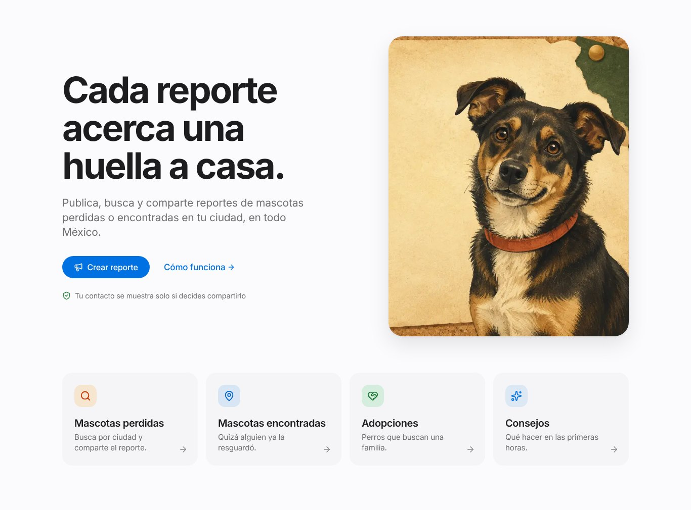
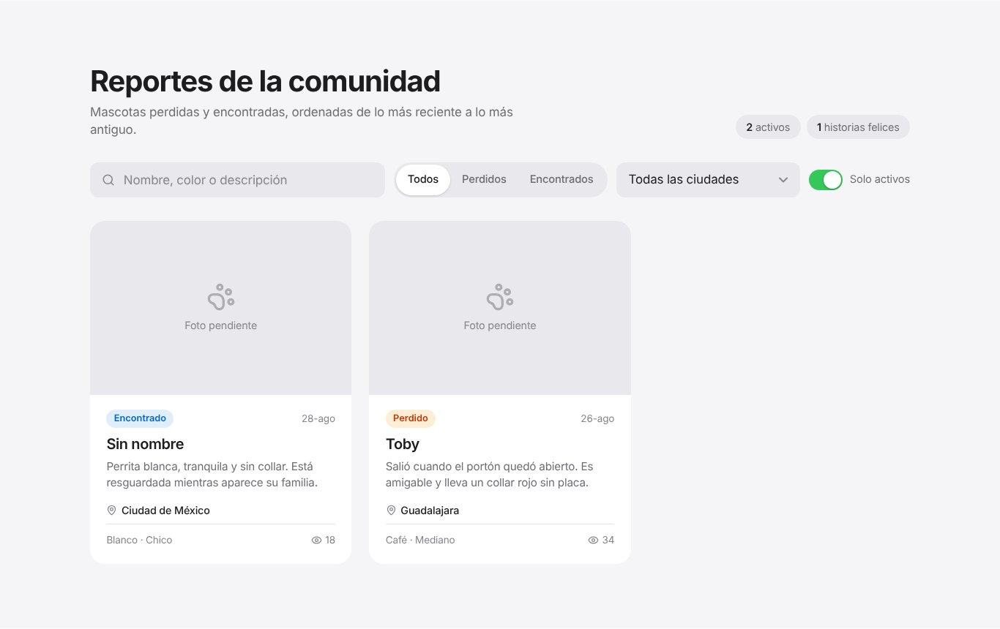
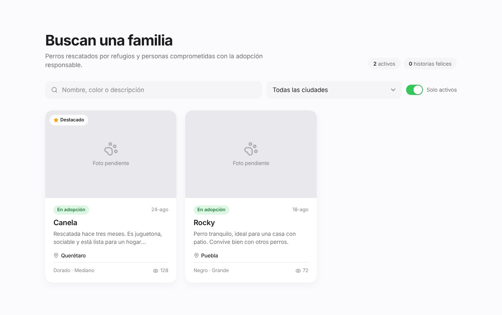
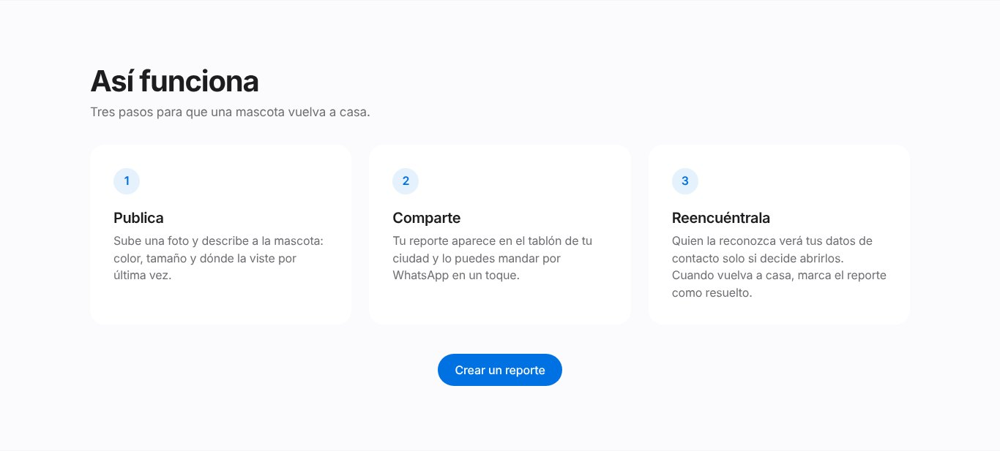
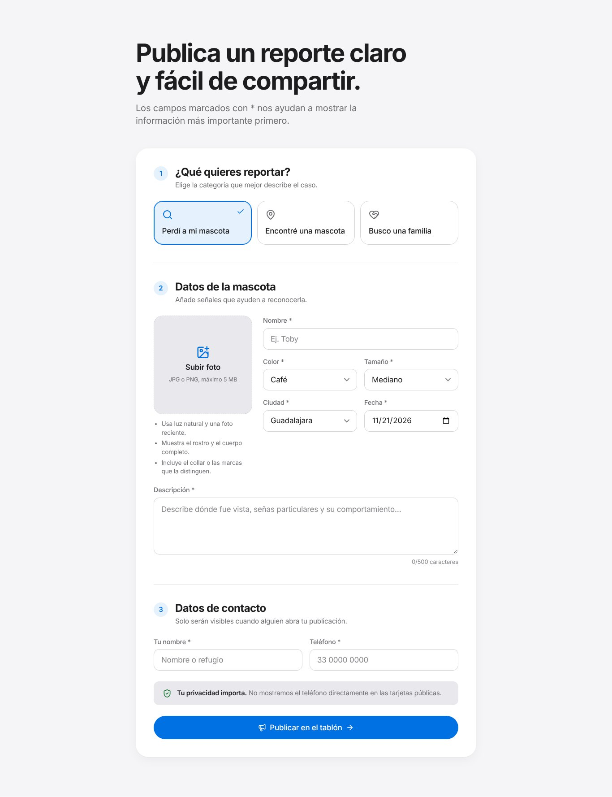
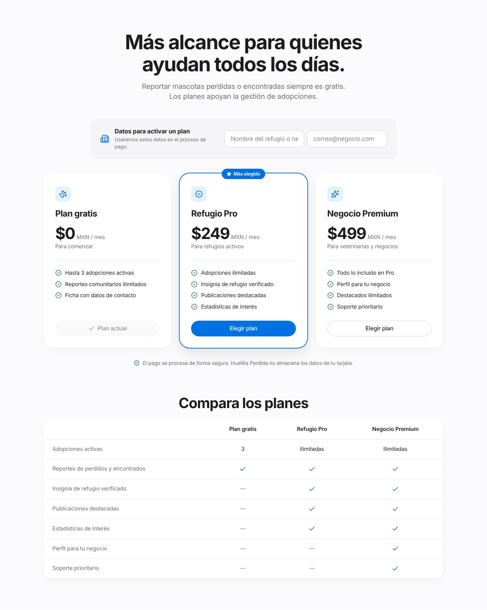
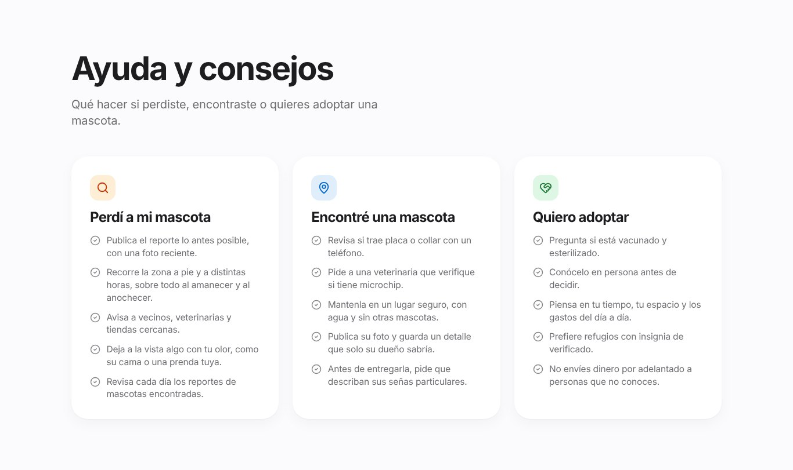
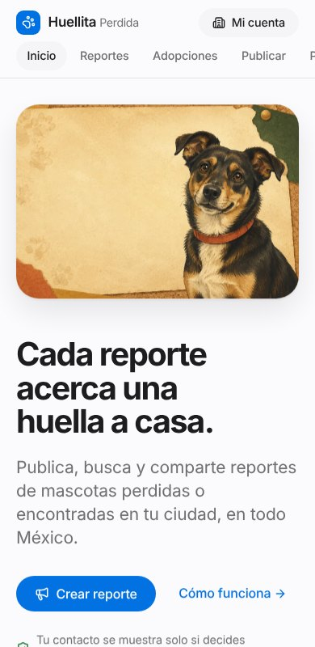

# Prototipos y maquetas

La maqueta visual parte de los wireframes y define color, tipografía, imágenes y estados de la interfaz. Después se implementó como un **prototipo funcional** en React. Las imágenes siguientes son capturas del prototipo en ejecución.

- Frontend publicado: <https://papijoshh.github.io/Huellitas/>
- Código fuente: <https://github.com/PapiJoshh/Huellitas>

## Lenguaje visual

- Fondo claro, tarjetas con esquinas redondeadas y sombras suaves.
- Color de acción azul para botones y enlaces, verde para confirmaciones y verificación, y un acento distinto para cada tipo de reporte: perdidas, encontradas y adopciones.
- Tipografía sans-serif con jerarquía marcada para títulos.
- Iconografía lineal de la biblioteca Lucide.

## Inicio



## Reportes



## Adopciones



## Cómo funciona



## Publicar



## Planes



## Ayuda



## Versión móvil



## Cómo ejecutar el prototipo

```bash
npm install --prefix frontend
npm install --prefix backend
npm run dev
```

El frontend queda en `http://localhost:5173` y la API en `http://localhost:3001`. Sin claves de Stripe, el pago funciona en modo demostración.
